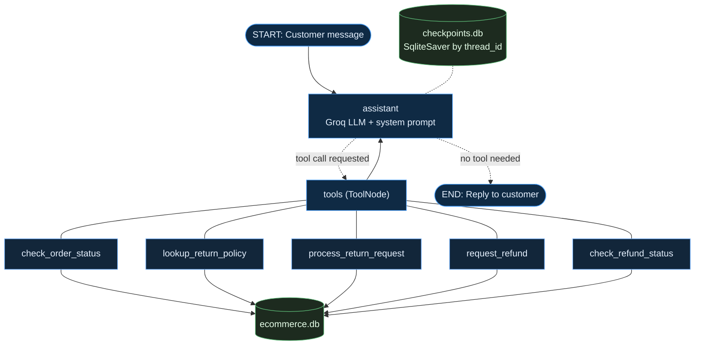

# AI Customer Support Agent with Human-in-the-Loop Review

An e-commerce support agent built with **LangGraph**. It answers order questions and creates return and refund requests using tools on a real **SQLite** database. A **human reviewer** makes every money decision.


> **Demo video:** [Watch on YouTube](https://youtu.be/ZRtKGp802qk)

## Summary and Problem

Support teams handle many repeat questions: order status, returns, refunds. A plain chatbot is risky because a wrong answer can mean a wrong refund.

This project uses a safer pattern:
- The LLM handles language and tool choice.
- Business rules (7-day window, delivery check, duplicate check) are in code, not the prompt.
- The agent only creates `requested` records. It can never approve a refund.
- A human approves or rejects in a review panel.

## Dataset

- Open e-commerce sample database, 31 CSV tables, loaded into SQLite with `pandas`.
- Demo orders 361–377 were added to test return, refund and review cases (377 orders in total).
- Most older orders are outside the 7-day window, so the demo orders cover the in-window cases.
- Tables created by the project: `refund_requests`, `return_refunds`, `return_review_notes`.

## Approach

ReAct pattern in LangGraph: the model decides, calls a tool, reads the result, then replies.



**System flow:** Next.js chat → FastAPI `/chat` → LangGraph agent → SQL tools → SQLite. Pending requests go to the Next.js review panel → human decision → SQLite.

| Tool | Purpose |
|---|---|
| `check_order_status` | Order status, items, tracking, delivery date |
| `lookup_return_policy` | 7-day window and valid reason IDs |
| `process_return_request` | Validates and creates a return request |
| `request_refund` | Submits an order refund for human review |
| `check_refund_status` | Shows review decisions and refund records |

**Safety design**
- Code validates item, delivery status, quantity, reason, duplicates and the 7-day window.
- The agent confirms item, quantity and reason with the customer before submitting.
- All SQL is parameterized (`?`). No f-string SQL.
- The prompt says "requested" is not "approved" and never to claim a refund was issued.
- Groq rate-limit errors return a friendly 503. Secrets stay in a git-ignored `.env`.

## Model

- **LLM:** `openai/gpt-oss-120b` on Groq (free tier) via `langchain-groq`, `temperature=0`.
- **Memory:** `SqliteSaver` in `checkpoints.db`, keyed by `conversation_id`.
- No model training. The focus is tool use, workflow design and safe automation.

## Human Review Flow

1. The customer asks for a return or refund. The agent validates it and creates a `requested` record.
2. The request appears in the review queue. The reviewer approves or rejects it and can add a note.
3. **Approve return:** refund is recorded and the payment is marked `refunded` when fully refunded.
4. **Approve order refund:** payments and order status become `refunded`.
5. **Reject:** status and note are saved. No money moves.
6. The customer can ask the agent for the decision.


## Results

Verified end to end (shown in the demo video with orders 375 and 376):
- Real order lookups return correct items, status and tracking.
- Returns are accepted or declined correctly by delivery status and the 7-day window.
- Approval in the review panel updates the database as designed.
- Chats resume with the same `conversation_id`.

> No accuracy metrics are reported. The project has not been formally evaluated yet.

## How to Run

**Requirements:** Python 3.10+, Node.js 20+, a free [Groq API key](https://console.groq.com).

```powershell
# Backend
python -m venv .venv
.venv\Scripts\activate
pip install -r requirements.txt
echo GROQ_API_KEY=your_key_here > .env
python load_data.py
uvicorn api:app --reload

# Frontend (new terminal)
cd frontend
npm install
npm run dev
```

- Chat: http://localhost:3000
- Review panel: http://localhost:3000/review
- API health: http://127.0.0.1:8000/health
- Change API address with `NEXT_PUBLIC_API_URL` in `frontend/.env.local`.
- Terminal options: `python agent.py` (chat), `python review.py` (review), `python test.py 1` (return flow).

## Tech Stack

LangGraph, LangChain Core, Groq (`langchain-groq`), SQLite, pandas, `langgraph-checkpoint-sqlite`, FastAPI, Uvicorn, Next.js 15, React 19, TypeScript.

## Project Structure

```
Customer_support_agent/
├── agent.py          # LangGraph agent, prompt, checkpointer
├── tools.py          # SQL tools + human review functions
├── api.py            # FastAPI: /chat, /health, /review/*
├── review.py         # Console review tool
├── load_data.py      # CSV to SQLite loader
├── test.py           # Quick return-flow test
├── ecommerce-csv/    # Dataset (31 CSV files)
├── docs/images/      # README screenshots
└── frontend/src/app/
    ├── page.tsx          # Customer chat
    └── review/page.tsx   # Review panel
```

## Author

**Chaitanya Krishna (Chey)** · GitHub: [Chaithanya449](https://github.com/Chaithanya449)
