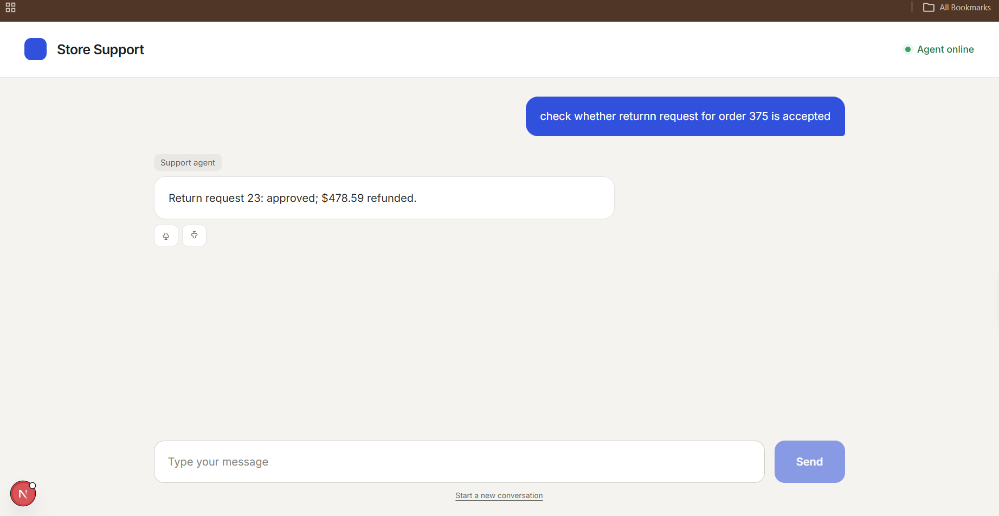
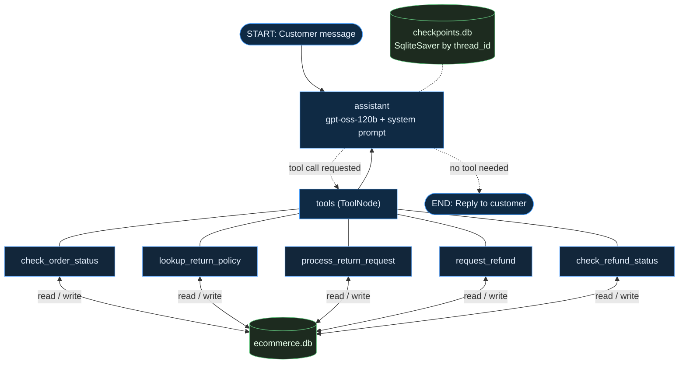
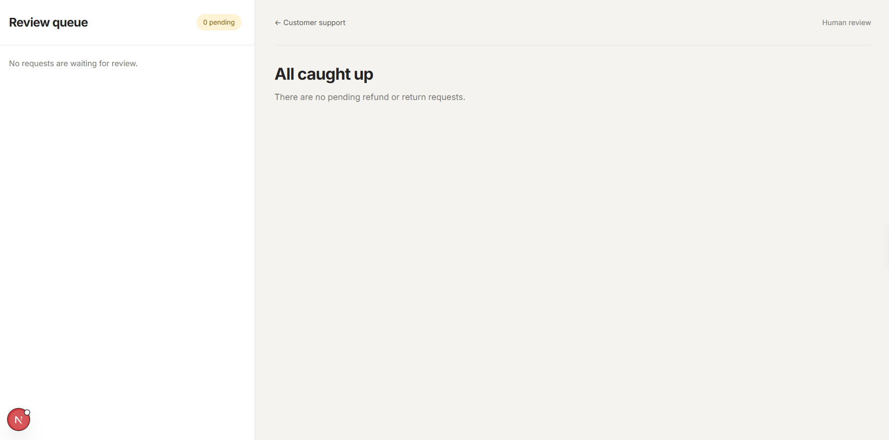

# AI Customer Support Agent with Human-in-the-Loop (HITL) Review

An e-commerce support agent built with **LangGraph**. It fetches order status, and handles return and refund requests using tools on a **SQLite** database. A **human reviewer** approves or rejects every return and refund.



> **Demo video:** [Watch on YouTube](https://youtu.be/ZRtKGp802qk)

## Project Summary

A customer chats with the agent. The agent uses tools to answer order questions and to raise return/refund requests. It never approves money itself. Requests go to a review panel, a human approves or rejects, and the `status` column in the `orders` table is updated with the outcome.

**Scope:** order status, return requests, return approval, refund requests, refund approval. Payment processing and refund timelines are out of scope. Other support topics are not covered.

> This is a demo, so I play both roles: the customer in the chat and the human reviewer in the review panel.

## Problem

E-commerce support teams get the same questions repeatedly: *Where is my order? What is the order status? When will it be delivered?*

This project handles that with a tool-using agent. The agent fetches order status (order ID, items, item IDs, shipment date, delivery date) through tools instead of guessing.

Returns and refunds are different. They involve money, so a wrong decision is costly. I kept a human in the loop for them. The agent only creates a `requested` record, and a human decides.

## Dataset

- Open e-commerce sample database, 31 CSV tables, loaded into SQLite with `pandas`.
- The records are from **2021**. The original data has 360 orders.
- Order `status` values (in the status table): `shipped`, `paid`, `pending`, `delivered`, `refunded`, `cancelled`.
- I fixed data inconsistencies in the records.
- I added 17 demo orders (361–377), so there are 377 orders in total.
- Tables created by the project: `refund_requests`, `return_refunds`, `return_review_notes`.

**Challenge I faced:** The agent enforces a 7-day return window. Because the data is from 2021, every return and refund request was declined, whatever I tried. Instead of rewriting dates with SQL, I created 17 new records (orders 361–377) designed to fall inside the window. This lets the agent send return and refund requests to the human reviewer, so the full flow can be demonstrated.

## Approach / Methodology

ReAct pattern in LangGraph: the model decides, calls a tool, reads the result, then replies.



**System flow:** Next.js chat → FastAPI `/chat` → LangGraph agent → SQL tools → SQLite. Pending requests go to the Next.js review panel → human decision → SQLite.

| Tool | Purpose |
|---|---|
| `check_order_status` | Order status, items, tracking, delivery date |
| `lookup_return_policy` | 7-day window and valid reason IDs |
| `process_return_request` | Validates and creates a return request |
| `request_refund` | Submits an order refund for human review |
| `check_refund_status` | Shows review decisions and refund records |

**Why human-in-the-loop:** A refund is critical, and so is any return  linked to a refund. The LLM handles language and tool choice. Rules are enforced in code.

Why a human handles return requests, not the agent: If the agent wrongly approved a return, a delivery agent would be sent for a pickup that should not happen, which wastes their time. The cost of that mistake is higher than the cost of a human review, so the approval stays with a human.

Why returns are linked to refunds: A refund after delivery is only possible once the return is accepted, so a return request is treated as refund-critical and also goes to the human reviewer. There is a second path: if a customer has paid and wants to cancel the order, they can raise an order refund request, which is also reviewed by a human.

**Safety design**
- Code validates item, delivery status, quantity, reason, duplicates and the 7-day window.
- The agent confirms item, quantity and reason with the customer before submitting.
- The agent can only create `requested` records. It cannot approve a refund.
- All SQL is parameterized (`?`). No f-string SQL.
  

**Human review flow**
1. The customer asks for a return or refund. The agent validates it and creates a `requested` record.
2. The request appears in the review queue. The reviewer approves or rejects it and can add a note.
3. **Approve return:** the decision is saved and the `status` column in the `orders` table is updated.
4. **Approve order refund:** the order `status` becomes `refunded`.
5. **Reject:** the decision and note are saved, and the request is closed as rejected.
6. The customer can ask the agent for the decision, and the answer comes from the database.

> **No payment is processed.** The app only tracks order status, return requests, return approval, refund requests and refund approval. It does not move money, and it does not tell the customer when a refund will reach them.

## Model / Algorithm

- **LLM:** `openai/gpt-oss-120b`, `temperature=0`.
- **Provider:** Groq API (free tier), used through `langchain-groq` (`ChatGroq`).
- **Agent:** ReAct tool-calling agent in LangGraph.
- **Memory:** `SqliteSaver` in `checkpoints.db`, keyed by `conversation_id`.
- No model training. The focus is tool use, workflow design and safe automation.

## Results

Verified end to end (shown in the demo video with orders 375 and 376):
- Order lookups return correct items, status and tracking from the database.
- Returns are accepted or declined by delivery status and the 7-day window.
- Return and refund requests reach the human reviewer.
- Approval or rejection in the review panel updates the order `status` in the database.
- Chats resume with the same `conversation_id`.

> No accuracy metrics are reported. The project has not been formally evaluated yet (see Next Steps).

## Key Visualizations

**Customer chat**


**Human review panel:** pending returns and refunds are approved or rejected here.



**Agent workflow:** see the flowchart in *Approach / Methodology*.

## How to Run

**Requirements:** Python 3.10+, Node.js 20+, a free [Groq API key](https://console.groq.com).

```powershell
# Backend
python -m venv .venv
.venv\Scripts\activate
pip install -r requirements.txt
echo GROQ_API_KEY=your_key_here > .env
python load_data.py
uvicorn api:app --reload

# Frontend (new terminal)
cd frontend
npm install
npm run dev
```

- Chat: http://localhost:3000
- Review panel: http://localhost:3000/review
- API health: http://127.0.0.1:8000/health
- Change the API address with `NEXT_PUBLIC_API_URL` in `frontend/.env.local`.
- Terminal options: `python agent.py` (chat), `python review.py` (review), `python test.py 1` (return flow).

## Tech Stack

LangGraph, LangChain Core, `openai/gpt-oss-120b` (served by Groq via `langchain-groq`), SQLite, pandas, `langgraph-checkpoint-sqlite`, FastAPI, Uvicorn, Next.js 15, React 19, TypeScript.

## Project Structure

```
ai-customer-support-agent/
├── agent.py            # LangGraph agent, prompt, checkpointer
├── tools.py            # SQL tools + human review functions
├── api.py              # FastAPI: /chat, /health, /review/*
├── review.py           # Console review tool
├── load_data.py        # CSV to SQLite loader
├── test.py             # Quick return-flow test
├── requirements.txt    # Python dependencies
├── ecommerce-csv/      # Dataset (31 CSV files)
├── screenshots/        # README screenshots
├── frontend/           # Next.js app
│   └── src/app/
│       ├── page.tsx          # Customer chat
│       └── review/page.tsx   # Review panel
└── readme.md
```

## Next Steps

- **Evaluation:** build a test set and measure tool-call accuracy, policy-rule correctness and refusal behavior.
- **Improve human-in-the-loop:** richer review panel, better reviewer notes and clearer escalation.
- **Dataset:** replace the hand-made demo orders with date-relative test data or a date-handling approach.
- **Scope:** extend to more support queries beyond order status, returns and refunds, and tell the customer the expected refund timeline.

## Author

**Chaitanya Krishna** · GitHub: [Chaithanya449](https://github.com/Chaithanya449) · LinkedIn: [chaitanyakrishna-profile](https://linkedin.com/in/chaitanyakrishna-profile)
